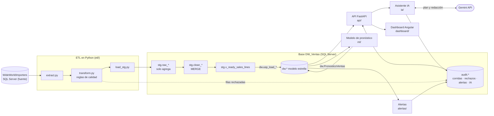

# Arquitectura de la solución

## Diagrama general

El navegador solo habla con la API. La API es la única pieza que consulta el Data Warehouse para el dashboard, y es de solo lectura (la excepción son dos escrituras acotadas: la bitácora del asistente y marcar una alerta como revisada).

## Componentes

| Componente | Carpeta | Qué hace | Tecnología |
|------------|---------|----------|------------|
| Fuente | — | Base operativa de ventas | SQL Server, WideWorldImporters |
| ETL | `etl/` | Extrae, limpia, valida y carga a staging y al DW | Python, pandas, SQLAlchemy, pyodbc |
| Base de datos | `database/` | Esquemas `stg`, `dw` y `audit`, procedimientos de carga, reconciliación | T-SQL |
| API | `api/` | Login, consultas del dashboard, pronóstico, alertas, asistente | FastAPI |
| Dashboard | `dashboard/` | Interfaz: resumen, asistente, alertas, monitoreo del ETL | Angular, Chart.js |
| Pronóstico | `ml/` | Entrena, compara contra baseline y guarda el pronóstico | scikit-learn |
| Asistente | `ia/` | Traduce preguntas a consultas controladas y redacta la respuesta | Gemini (API REST) |
| Alertas | `alertas/` | Evalúa reglas de negocio y registra las alertas | Python |
| Pruebas | `tests/` | Reglas de calidad, API, modelo, asistente y alertas | pytest |

## Capas de datos

| Esquema | Contenido | Para qué |
|---------|-----------|----------|
| `stg` | `raw_*` (tal como llegó, con `_execution_id` y `_extracted_at`) y `clean_*` (validado, una fila por clave) | Trazabilidad y limpieza |
| `dw` | `FactSales`, `DimDate`, `DimCustomer`, `DimProduct`, `DimSalesperson`, `PronosticoVentas` | Consulta analítica |
| `audit` | `etl_runs`, `watermarks`, `rejected_rows`, `ml_metricas`, `asistente_consultas`, `alertas` | Control, evidencia y monitoreo |

## Orquestación

`python -m etl.run_pipeline` es el único punto de entrada del ETL. Ejecuta en orden:

1. Staging de las cinco entidades (people, products, customers, invoices, invoice_lines). El orden importa: las líneas se validan contra facturas ya cargadas.
2. Carga del Data Warehouse (`dw.usp_load_*`).
3. Evaluación de alertas.

El pronóstico se reentrena aparte (`python -m ml.entrenar`) cuando hay un mes nuevo completo. Cada paso queda en `audit.etl_runs` con su `execution_id`. Detalle en [ETL y calidad](07_etl_y_calidad.md).

## Decisiones principales

| Decisión | Elegido | Por qué |
|----------|---------|---------|
| Herramienta ETL | Python + SQL | Proyecto pequeño; Airflow o Docker agregarían complejidad sin beneficio |
| Modelo | Estrella | Más simple de consultar y de explicar; no hay jerarquías que pidan copo de nieve |
| Dónde se calcula | En SQL Server | Los KPI se agregan en la base, no en el navegador |
| Acceso del frontend | Solo por la API | La guía prohíbe conectar el frontend directo a SQL Server |
| IA generativa | Elige consultas de un catálogo fijo; no escribe SQL | Evita inyección y cifras inventadas |
| Pronóstico | Modelos simples con validación hacia adelante | Con 41 meses de datos un modelo complejo no se justifica |

Las decisiones del modelo de datos están en [Alcance y decisiones](01_alcance_y_decisiones.md).

## Seguridad

- Login con usuario y clave definidos en `.env`; la API devuelve un token firmado (HMAC) que el dashboard envía en cada petición.
- Todo filtro del usuario viaja como parámetro SQL, nunca pegado al texto de la consulta.
- El asistente no ejecuta SQL: su salida se valida contra un catálogo, y los grupos, territorios y fechas se verifican antes de consultar.
- `.env` está en `.gitignore`; el repositorio solo trae `.env.example`.
- CORS limitado al origen del dashboard (`http://localhost:4200`).

## Costos y alternativas

Todo corre sin pago: SQL Server Express, Python, Node y Angular son gratuitos, y Gemini se usa con la capa gratuita (con límites de uso y modelos que cambian de nombre, por eso el modelo y su respaldo se configuran en `.env`). Alternativa local sin costo para el asistente: un modelo con Ollama, cambiando solo `ia/gemini.py`.
