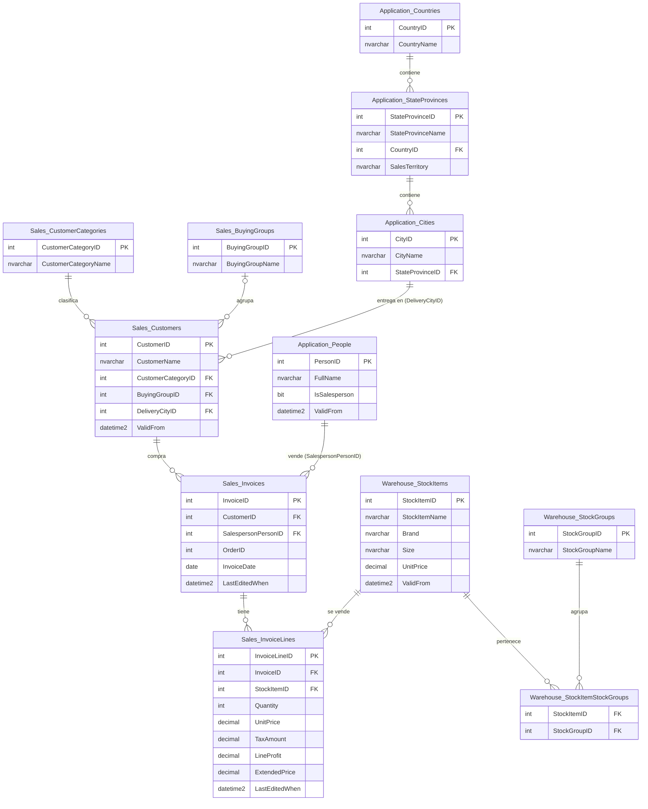

# Fuente: WideWorldImporters

Base operativa de ventas de una distribuidora ficticia, en SQL Server. Se usan 12 tablas. El resto de la base (compras, bodega, transporte) no interviene en el proceso de ventas elegido.

## ERD de las tablas relevantes

Los nombres usan guion bajo en el diagrama (`Sales_Invoices`) porque el lenguaje del diagrama no admite puntos; en la base son `Sales.Invoices`.

## Inventario y volúmenes

| Tabla | Rol | Filas cargadas |
|-------|-----|---------------:|
| `Sales.InvoiceLines` | Transaccional: una línea por producto facturado | 228,265 |
| `Sales.Invoices` | Transaccional: cabecera de la factura | 70,510 |
| `Sales.Customers` | Catálogo (temporal) | 663 |
| `Warehouse.StockItems` | Catálogo (temporal) | 227 |
| `Application.People` | Catálogo, filtrado a vendedores (`IsSalesperson = 1`) | 10 |
| `Sales.CustomerCategories`, `Sales.BuyingGroups`, `Application.Cities`, `Application.StateProvinces`, `Application.Countries`, `Warehouse.StockGroups`, `Warehouse.StockItemStockGroups` | Catálogos de apoyo, solo para enriquecer | — |

Rango de fechas de facturas: 2013-01-01 a 2016-05-31.

## Diccionario de datos (columnas usadas)

### Sales.InvoiceLines

| Columna | Tipo | Significado | Uso en el proyecto |
|---------|------|-------------|--------------------|
| `InvoiceLineID` | int, PK | Identificador de la línea | Clave de negocio del hecho y grano del DW |
| `InvoiceID` | int, FK | Factura a la que pertenece | Une con la cabecera para obtener fecha, cliente y vendedor |
| `StockItemID` | int, FK | Producto vendido | Clave de la dimensión producto |
| `Quantity` | int | Unidades vendidas | Medida aditiva |
| `UnitPrice` | decimal(18,2) | Precio unitario | Medida no aditiva |
| `TaxAmount` | decimal(18,2) | Impuesto de la línea | Medida aditiva |
| `LineProfit` | decimal(18,2) | Ganancia de la línea | Medida aditiva |
| `ExtendedPrice` | decimal(18,2) | Total de la línea con impuesto | Medida aditiva; base de `NetSales` |
| `LastEditedWhen` | datetime2 | Última modificación | Columna de control del incremental |

### Sales.Invoices

| Columna | Tipo | Significado | Uso |
|---------|------|-------------|-----|
| `InvoiceID` | int, PK | Identificador de la factura | Clave de negocio |
| `CustomerID` | int, FK | Cliente | Dimensión cliente |
| `SalespersonPersonID` | int, FK | Vendedor | Dimensión vendedor |
| `OrderID` | int | Pedido de origen | Se conserva en staging |
| `InvoiceDate` | date | Fecha de la factura | Dimensión fecha |
| `LastEditedWhen` | datetime2 | Última modificación | Control del incremental |

### Sales.Customers (y catálogos que la enriquecen)

| Columna | Tipo | Significado | Uso |
|---------|------|-------------|-----|
| `CustomerID` | int, PK | Cliente | Clave de negocio |
| `CustomerName` | nvarchar | Nombre | Atributo (tipo 1) |
| `CustomerCategoryID` → `CustomerCategoryName` | int → nvarchar | Categoría (por ejemplo Novelty Shop, Supermarket) | Atributo con historia (tipo 2) |
| `BuyingGroupID` → `BuyingGroupName` | int, nulo → nvarchar | Grupo de compra; nulo si no pertenece a uno | Tipo 2; nulo pasa a `No aplica` |
| `DeliveryCityID` → ciudad, provincia, país, `SalesTerritory` | int → nvarchar | Ubicación de entrega y territorio de ventas | Tipo 2 |
| `ValidFrom` | datetime2 | Inicio de la versión vigente (tabla temporal) | Fecha del cambio en el SCD tipo 2; se extrae como `LastEditedWhen` |

### Warehouse.StockItems

| Columna | Tipo | Significado | Uso |
|---------|------|-------------|-----|
| `StockItemID` | int, PK | Producto | Clave de negocio |
| `StockItemName` | nvarchar | Nombre | Atributo |
| `Brand` | nvarchar, nulo | Marca | Nulo pasa a `Sin marca` |
| `Size` | nvarchar, nulo | Talla o medida | Nulo pasa a `N/A` |
| `UnitPrice` | decimal | Precio de lista | Se valida; no se guarda en la dimensión |
| grupo (`StockGroupName`) | nvarchar | Grupo de producto, vía `StockItemStockGroups` | Un producto puede estar en varios grupos; se toma el de menor `StockGroupID` para no duplicar filas |

### Application.People

| Columna | Tipo | Significado | Uso |
|---------|------|-------------|-----|
| `PersonID` | int, PK | Persona | Clave de negocio del vendedor |
| `FullName` | nvarchar | Nombre completo | Atributo |
| `IsSalesperson` | bit | Es vendedor | Filtro de extracción (10 personas) |

## Perfil de los datos

`python -m etl.profiling` calcula nulos, cardinalidad y rangos de las tablas de origen. Hallazgos que cambiaron el diseño:

- Los catálogos son tablas temporales: no tienen `LastEditedWhen`, tienen `ValidFrom`.
- `Brand`, `Size` y `BuyingGroupID` traen nulos que significan "no aplica", no error.
- No hay facturas con fecha futura, líneas huérfanas ni duplicados: en las cargas reales no se rechazó ninguna fila. Por eso las reglas de calidad se probaron además con datos sucios fabricados ([ver pruebas](11_pruebas.md)).
- Un producto puede pertenecer a varios grupos de producto.
