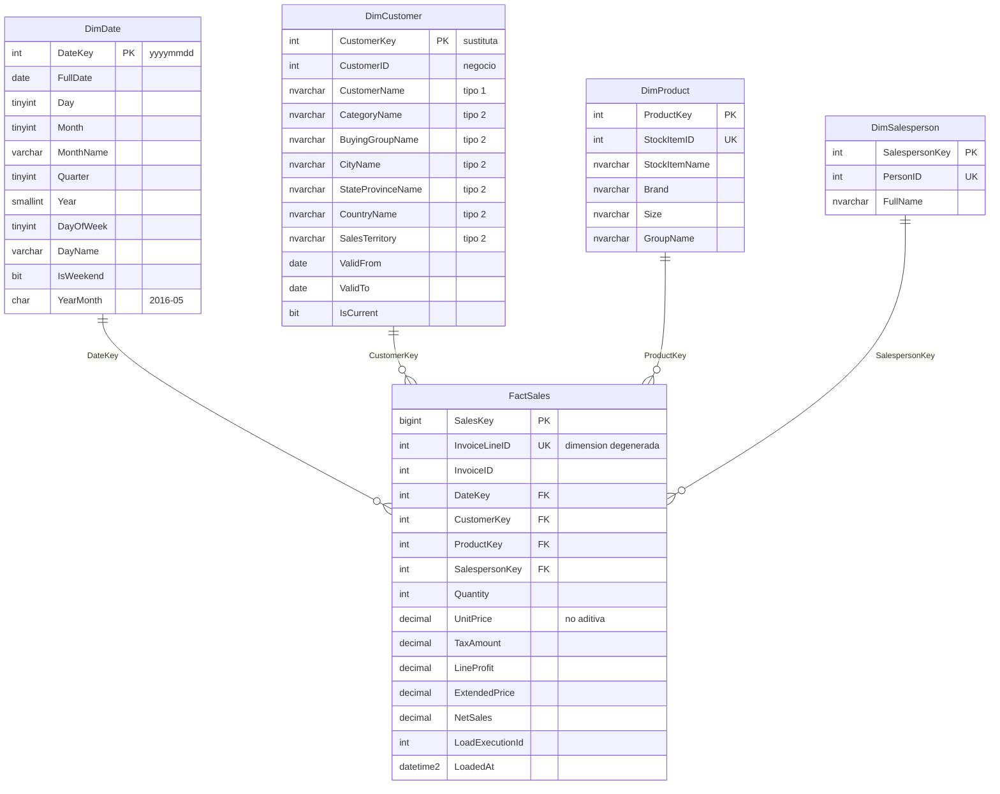

# Modelo dimensional (Data Warehouse `DW_Ventas`)

Proceso de negocio: **ventas**. Esquema en estrella con una tabla de hechos y cuatro dimensiones.

## Diagrama

## Grano

**Una fila de `FactSales` es una línea de factura** (`Sales.InvoiceLines`). `InvoiceLineID` es una dimensión degenerada con restricción `UNIQUE`: garantiza que cada línea exista una sola vez, aunque la carga se repita.

## Medidas

| Medida | Tipo | Definición | Cómo se agrega |
|--------|------|------------|----------------|
| `Quantity` | Aditiva | Unidades vendidas | `SUM` |
| `NetSales` | Aditiva | `ExtendedPrice - TaxAmount`: venta sin impuesto. Es la cifra que muestran dashboard, asistente, pronóstico y alertas | `SUM` |
| `ExtendedPrice` | Aditiva | Total de la línea con impuesto | `SUM` |
| `TaxAmount` | Aditiva | Impuesto | `SUM` |
| `LineProfit` | Aditiva | Ganancia de la línea | `SUM` |
| `UnitPrice` | **No aditiva** | Precio por unidad | Nunca se suma; se promedia ponderado por cantidad |

Los ratios (margen, ticket promedio) se calculan sobre totales, no promediando promedios: margen = `SUM(LineProfit) / SUM(NetSales)`; ticket = `SUM(NetSales) / COUNT(DISTINCT InvoiceID)`.

## Dimensiones y estrategia de historia

| Dimensión | Clave sustituta | Clave de negocio | Tipo | Detalle |
|-----------|-----------------|------------------|------|---------|
| `DimDate` | `DateKey` (yyyymmdd) | — | Fija | Generada de 2012-01-01 a 2030-12-31 |
| `DimCustomer` | `CustomerKey` (identity) | `CustomerID` | **Tipo 2** en categoría, grupo de compra y ubicación; **tipo 1** en nombre | `ValidFrom`/`ValidTo`/`IsCurrent`; índice único filtrado: un solo vigente por cliente |
| `DimProduct` | `ProductKey` | `StockItemID` | Tipo 1 | Un cambio sobrescribe |
| `DimSalesperson` | `SalespersonKey` | `PersonID` | Tipo 1 | Un cambio sobrescribe |

**SCD tipo 2 en clientes.** Cuando cambia un atributo con historia, el procedimiento cierra la versión vigente (`ValidTo` = día anterior al cambio, `IsCurrent = 0`) y crea una nueva desde la fecha del cambio (el `ValidFrom` de la tabla temporal de la fuente). Un cliente nuevo arranca con `ValidFrom = 1900-01-01` para cubrir todo el historial. Al cargar los hechos, cada línea toma la versión del cliente vigente en la fecha de su factura (`InvoiceDate BETWEEN ValidFrom AND ValidTo`), así las ventas se analizan con la categoría que el cliente tenía en ese momento.

**Miembro desconocido.** Cada dimensión tiene la fila `-1 / Desconocido`. Un hecho cuya dimensión no se encuentra se carga con clave `-1` en lugar de perderse, y queda visible en la reconciliación (`database/06`, punto 4).

## Diccionario del Data Warehouse

### dw.FactSales

| Columna | Tipo | Nulo | Descripción |
|---------|------|------|-------------|
| `SalesKey` | bigint identity, PK | No | Clave sustituta del hecho |
| `InvoiceLineID` | int, UNIQUE | No | Línea de factura de origen (grano) |
| `InvoiceID` | int | No | Factura, para contar facturas distintas |
| `DateKey` | int, FK | No | Fecha de la factura |
| `CustomerKey` | int, FK | No | Versión del cliente vigente en esa fecha |
| `ProductKey` | int, FK | No | Producto |
| `SalespersonKey` | int, FK | No | Vendedor |
| `Quantity` | int | No | Unidades |
| `UnitPrice` | decimal(18,2) | No | Precio unitario (no aditiva) |
| `TaxAmount` | decimal(18,2) | No | Impuesto |
| `LineProfit` | decimal(18,2) | No | Ganancia |
| `ExtendedPrice` | decimal(18,2) | No | Total con impuesto |
| `NetSales` | decimal(18,2) | No | Venta neta (sin impuesto) |
| `LoadExecutionId` | int | Sí | Corrida de `audit.etl_runs` que la insertó o actualizó |
| `LoadedAt` | datetime2 | No | Momento de carga |

Índices: `IX_FactSales_Date` (`DateKey` con `NetSales`, `Quantity`, `LineProfit` incluidas), `IX_FactSales_Customer`, `IX_FactSales_Product`.

### dw.DimDate

| Columna | Tipo | Descripción |
|---------|------|-------------|
| `DateKey` | int, PK | Fecha como yyyymmdd |
| `FullDate` | date | Fecha |
| `Day`, `Month`, `Year` | tinyint, tinyint, smallint | Partes de la fecha |
| `MonthName`, `DayName` | varchar | Nombres en español |
| `Quarter` | tinyint | Trimestre |
| `DayOfWeek` | tinyint | 1 = lunes … 7 = domingo |
| `IsWeekend` | bit | Sábado o domingo |
| `YearMonth` | char(7) | `2016-05`; agrupa las series mensuales |

### dw.DimCustomer

| Columna | Tipo | Descripción |
|---------|------|-------------|
| `CustomerKey` | int identity, PK | Clave sustituta (una por versión) |
| `CustomerID` | int | Clave de negocio |
| `CustomerName` | nvarchar(100) | Nombre (tipo 1) |
| `CategoryName` | nvarchar(50) | Categoría de cliente (tipo 2) |
| `BuyingGroupName` | nvarchar(50) | Grupo de compra; `No aplica` si no tiene (tipo 2) |
| `CityName`, `StateProvinceName`, `CountryName` | nvarchar | Ubicación (tipo 2) |
| `SalesTerritory` | nvarchar(50) | Territorio de ventas (tipo 2) |
| `ValidFrom`, `ValidTo` | date | Vigencia de la versión (`9999-12-31` si sigue vigente) |
| `IsCurrent` | bit | 1 si es la versión vigente |

### dw.DimProduct

| Columna | Tipo | Descripción |
|---------|------|-------------|
| `ProductKey` | int identity, PK | Clave sustituta |
| `StockItemID` | int, UNIQUE | Clave de negocio |
| `StockItemName` | nvarchar(100) | Nombre del producto |
| `Brand` | nvarchar(50) | Marca; `Sin marca` si no tiene |
| `Size` | nvarchar(20) | Talla o medida; `N/A` si no aplica |
| `GroupName` | nvarchar(50) | Grupo de producto; `Sin grupo` si no tiene |

### dw.DimSalesperson

| Columna | Tipo | Descripción |
|---------|------|-------------|
| `SalespersonKey` | int identity, PK | Clave sustituta |
| `PersonID` | int, UNIQUE | Clave de negocio |
| `FullName` | nvarchar(50) | Nombre del vendedor |

### dw.PronosticoVentas

| Columna | Tipo | Descripción |
|---------|------|-------------|
| `ml_run_id` | int | Corrida de `audit.etl_runs` que generó el pronóstico |
| `version` | nvarchar | Versión del modelo (`v` + fecha y hora) |
| `modelo` | nvarchar | Modelo elegido |
| `mes` | char(7) | Mes pronosticado |
| `horizonte_mes` | int | 1 a 6 meses hacia adelante |
| `valor`, `inferior`, `superior` | decimal | Pronóstico y rango del 80 % |
| `base_hasta` | char(7) | Último mes real usado |
| `generado_en` | datetime2 | Cuándo se generó |

## Staging

| Tabla | Contenido | Clave |
|-------|-----------|-------|
| `stg.raw_<entidad>` | Lo extraído sin modificar, más `_execution_id` y `_extracted_at`. En carga completa se vacía primero; en incremental solo agrega | — |
| `stg.clean_people`, `clean_products`, `clean_customers`, `clean_invoices`, `clean_invoice_lines` | Datos validados, una fila por clave de negocio; se actualizan con `MERGE` | `PersonID`, `StockItemID`, `CustomerID`, `InvoiceID`, `InvoiceLineID` |
| `stg.v_ready_sales_lines` | Vista: línea + cabecera de factura + `NetSales`. Es la única entrada del procedimiento que carga los hechos | — |

## Auditoría

| Tabla | Contenido |
|-------|-----------|
| `audit.etl_runs` | Una fila por paso ejecutado: `pipeline_name`, tiempos, filas leídas / insertadas / actualizadas / rechazadas, `status` (`RUNNING`, `SUCCESS`, `FAILED`), `error_detail`, watermark |
| `audit.watermarks` | Último `LastEditedWhen` cargado por entidad incremental |
| `audit.rejected_rows` | Cuarentena: `execution_id`, tabla de origen, clave, `rule_name` y detalle |
| `audit.ml_metricas` | Métricas de cada modelo comparado en cada entrenamiento |
| `audit.asistente_consultas` | Bitácora del asistente: pregunta, consultas usadas, respuesta, si respondió, modelo, duración |
| `audit.alertas` | Alertas generadas, únicas por regla, periodo y ámbito |

## Consultas de reconciliación

`database/06_reconciliacion.sql` compara origen, staging y DW (conteos y venta neta contra un cálculo independiente de cantidad por precio), lista los rechazos por regla, los hechos que cayeron en `Desconocido` y los clientes con más de una versión. Resultado de la carga real: 228,265 líneas en origen, en `stg.clean_invoice_lines` y en `dw.FactSales`, sin rechazos.
