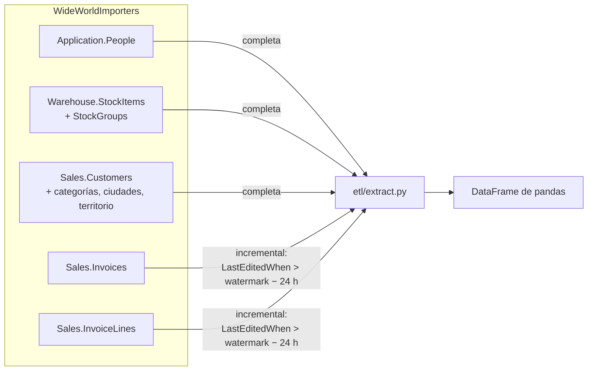
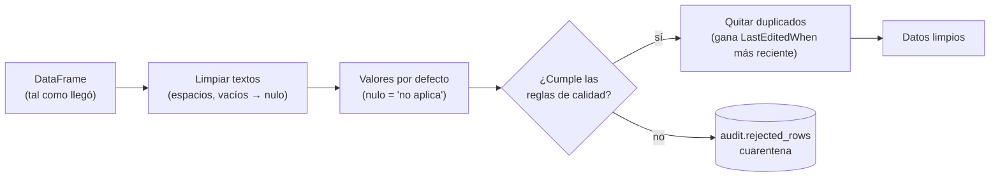
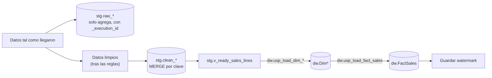
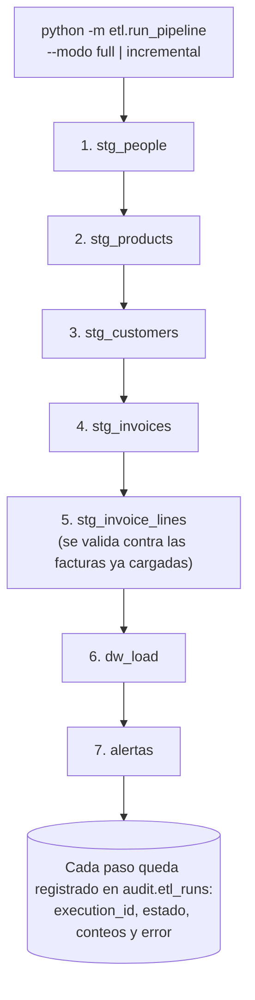

# ETL y calidad de datos

El ETL está en `etl/` y se ejecuta con `python -m etl.run_pipeline`. Pasa por tres capas dentro de `DW_Ventas`: `stg.raw_*` (lo que llegó), `stg.clean_*` (validado) y `dw.*` (modelo estrella).

## Extracción

- Las dimensiones (personas, productos, clientes) son pequeñas: se leen completas siempre.
- Facturas y líneas se leen de forma incremental con un **watermark** por tabla (`audit.watermarks`) y 24 horas de solapamiento, por si llegan registros tardíos.
- Los joins de las dimensiones son uno a uno por clave. Un producto puede estar en varios grupos: se toma el de menor ID para no duplicar filas.

## Transformación

## Carga

El `MERGE` solo actualiza una fila si algún valor cambió de verdad (se compara con `EXCEPT`), así que volver a correr una carga no cuenta cambios falsos. Las dimensiones se resuelven antes de insertar los hechos. Un hecho sin dimensión cae en el miembro `-1 Desconocido`, no se pierde.

## Orquestación

No usé Airflow: para este tamaño un solo comando alcanza y es más fácil de explicar y de reproducir.

El orden importa: las líneas se validan contra las facturas ya cargadas, por eso las facturas van antes. Si la evaluación de alertas falla, la carga de datos ya quedó bien hecha y solo se muestra un aviso. El pronóstico se reentrena aparte: `python -m ml.entrenar`.

## Carga completa e incremental

| | Completa (`--modo full`) | Incremental (`--modo incremental`) |
|---|---|---|
| Cuándo | Primera vez o para reconstruir | Uso normal |
| `stg.raw_*` | Se vacía y se vuelve a llenar | Se agregan las filas leídas |
| Qué se lee | Todo | Facturas y líneas con `LastEditedWhen` posterior al watermark menos 24 h |
| `stg.clean_*` y `dw.*` | `MERGE` | `MERGE` (mismo resultado, sin duplicar) |

## Idempotencia y recuperación

- **Idempotencia:** `MERGE` por clave de negocio + comparación `EXCEPT` + `UNIQUE (InvoiceLineID)` en los hechos. Correr dos veces el mismo lote deja los mismos datos.
- **Recuperación:** cada paso es una corrida en `audit.etl_runs`. Si falla, queda como `FAILED` con el texto del error y el watermark de esa tabla **no avanza** (se guarda solo después de cargar bien). Al reintentar se vuelve a leer desde el mismo punto y el `MERGE` evita duplicados.
- **Trazabilidad:** cada fila de `raw` guarda `_execution_id` y `_extracted_at`; cada hecho, pronóstico y alerta guarda el `execution_id` que la generó.

## Catálogo de reglas de calidad y transformación

Todas están en `etl/transform.py` y tienen prueba automática. Lo que se rechaza va a `audit.rejected_rows` con la regla, la clave de negocio y el detalle; la carga continúa.

| Tabla | Regla | Condición | Acción |
|---|---|---|---|
| Todas | Limpieza de texto | Espacios repetidos o de sobra; texto vacío | Se normalizan; vacío pasa a nulo |
| Todas | `duplicado` | Misma clave con otra versión más reciente | Se rechaza la versión vieja; gana la de `LastEditedWhen` mayor |
| People | `nombre_vacio` | `FullName` nulo o vacío | Rechazar |
| StockItems | `nombre_vacio` | `StockItemName` nulo o vacío | Rechazar |
| StockItems | `precio_invalido` | `UnitPrice` nulo o negativo | Rechazar |
| StockItems | Nulos que significan "no aplica" | `Brand`, `Size`, `GroupName` nulos | Se cambian por `Sin marca`, `N/A`, `Sin grupo` |
| Customers | `nombre_vacio` | `CustomerName` nulo o vacío | Rechazar |
| Customers | Nulo que significa "no aplica" | `BuyingGroupName` nulo | Se cambia por `No aplica` |
| Invoices | `fecha_nula` | `InvoiceDate` nula o inválida | Rechazar |
| Invoices | `fecha_futura` | `InvoiceDate` posterior a hoy | Rechazar |
| Invoices | `llave_nula` | Sin cliente o sin vendedor | Rechazar |
| InvoiceLines | `campo_obligatorio_nulo` | Algún campo numérico obligatorio nulo | Rechazar |
| InvoiceLines | `cantidad_no_positiva` | `Quantity` ≤ 0 | Rechazar |
| InvoiceLines | `precio_negativo` | `UnitPrice` < 0 | Rechazar |
| InvoiceLines | `factura_inexistente` | La factura no está en `stg.clean_invoices` | Rechazar (integridad referencial) |

**Política de integridad en el DW:** un hecho cuya dimensión no se encuentra se carga con la clave `-1` (`Desconocido`) y se cuenta en la reconciliación. Las líneas sin factura no llegan al DW porque se rechazan antes, ya que sin factura no hay fecha ni cliente.

## Resultados reales

**Carga inicial** (`--modo full`, ejecuciones 1 a 6):

| Paso | Leídas | Insertadas | Rechazadas |
|---|---:|---:|---:|
| stg_people | 10 | 10 | 0 |
| stg_products | 227 | 227 | 0 |
| stg_customers | 663 | 663 | 0 |
| stg_invoices | 70,510 | 70,510 | 0 |
| stg_invoice_lines | 228,265 | 228,265 | 0 |
| dw_load | — | 228,265 | — |

**Reconciliación** (`database/06_reconciliacion.sql`): 228,265 líneas en el origen, en `stg.clean_invoice_lines` y en `dw.FactSales`; la venta neta del DW se compara con un cálculo independiente (`Quantity × UnitPrice`) desde el origen.

**Incremental sin cambios** (ejecuciones 7 a 12): se releyeron 162 facturas y 284 líneas por la ventana de solapamiento, y se insertó y actualizó **0**. Ahí se ve la idempotencia.

**Incremental con cambios** (`tests/sql/simular_cambios_origen.sql`): cambia la categoría de un cliente, toca cinco líneas sin cambiar valores y modifica la ganancia de una. El cliente queda con dos versiones en `DimCustomer` (SCD tipo 2). En staging se cuentan 6 líneas actualizadas porque `LastEditedWhen` también se guarda ahí; en el DW solo cuenta como actualizada la línea con un valor distinto.

**Datos sucios** (`python -m tests.datos_sucios`): WideWorldImporters viene muy limpia y la carga real rechazó 0 filas, así que se fabrican filas malas a propósito y se pasan por las mismas reglas. Resultado: **13 rechazos** (people 1, products 2, customers 1, invoices 4, invoice_lines 5), todos en `audit.rejected_rows`.
