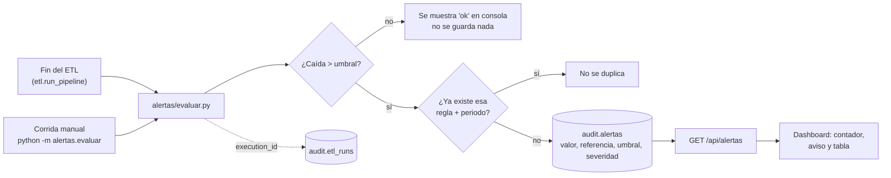

# Alertas y automatización

Avisan cuando las ventas caen de forma anormal. Código en `alertas/`, tabla `audit.alertas`, pestaña *Alertas* del dashboard.

## Reglas

| Regla | Compara | Se dispara si |
|---|---|---|
| `caida_mensual` | Ventas netas del mes contra el mes anterior | Caen **más de 15 %** |
| `caida_interanual` | Ventas netas del mes contra el mismo mes del año anterior | Caen **más de 15 %** |

- El umbral es configurable (`ALERTA_UMBRAL_PCT` en `.env` o `--umbral`). Una caída de exactamente 15 % **no** dispara.
- **Severidad:** `MEDIA`, o `ALTA` si la caída es de 30 % o más.
- Se mira el total de ventas netas de todo el negocio (ámbito `Global`).
- **Mes a medias:** solo se evalúa un mes completo (los datos deben llegar a su último día); si no, se evalúa el anterior. Un mes cortado siempre parecería una caída.
- **Sin referencia:** si falta el mes con el que comparar (por ejemplo el primer mes de la historia, o el año anterior en 2013), esa regla se omite; no se inventa un dato.

## Flujo

## Registro y entrega

- **Registro:** cada alerta guarda regla, periodo, valor del mes, valor de referencia, variación %, umbral vigente, severidad, mensaje, estado (`NUEVA`/`REVISADA`), `execution_id`, fecha de creación y de revisión.
- **Sin duplicados:** la restricción `UNIQUE (regla, periodo, ambito)` de la tabla lo garantiza aunque el proceso corra varias veces.
- **Entrega:** notificación web dentro del dashboard: un contador en el menú, un aviso rojo visible en todas las páginas y la tabla de alertas, donde se puede marcar cada una como revisada. No se envía correo (ver límites).
- **Monitoreo:** cada evaluación queda como una corrida `alertas` en `audit.etl_runs`, visible en *Monitoreo ETL*.

## Cuándo corre

- Automáticamente al final de cada `python -m etl.run_pipeline`. Si la evaluación falla, la carga de datos ya está hecha y solo se muestra un aviso.
- A mano: `python -m alertas.evaluar` (último mes completo), `--mes AAAA-MM` o `--historico`.

## Pruebas

**Automáticas** (`tests/test_alertas.py`, 15 pruebas): dispara con 20 %; no dispara con 10 %; justo 15 % no dispara y 15.1 % sí; un crecimiento no dispara; severidad alta desde 30 %; comparación interanual; sin mes de referencia no se evalúa; umbral configurable; aritmética de meses; mes a medias; no duplica; el endpoint filtra por estado con parámetros y exige token.

**Con datos reales:**

| Corrida | Resultado |
|---|---|
| `python -m alertas.evaluar` (2016-05) | Mensual **+8.9 %**, interanual **+10.9 %** → `ok`, **no dispara** |
| `python -m alertas.evaluar --mes 2013-02` | Mensual **−26.4 %** (de $3,770,411 a $2,776,786) → **ALERTA** (severidad media), 1 alerta nueva |
| La misma otra vez | `alertas nuevas: 0 | ya registradas: 1` → **no duplica** |

La interanual de 2013-02 no se evalúa porque no hay datos de 2012.

Las alertas de meses pasados (como 2013-02) son caídas reales de la historia, evaluadas a propósito para la demostración; en producción solo se evaluaría el último mes cargado.

## Límites

- Solo mira el total del negocio; no hay alertas por producto, cliente o territorio.
- La caída mensual es sensible a la estacionalidad (febrero suele ser flojo); por eso existe también la regla interanual.
- Entrega solo por la web. Enviar correo (SMTP) está fuera del alcance y se podría agregar leyendo las alertas con estado `NUEVA`.
- La evaluación es por lotes: no avisa en tiempo real, sino cuando corre el ETL o se ejecuta a mano.
